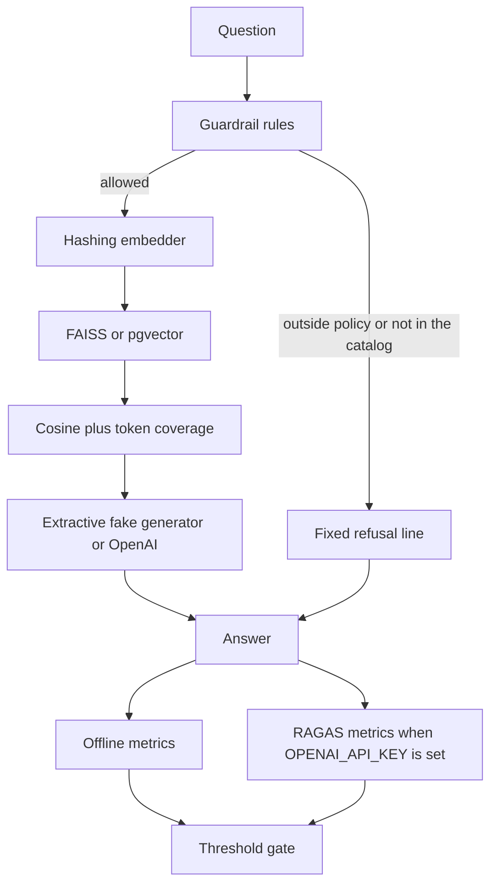

# ecommerce-product-rag-evals

[](https://github.com/mustafaautomation/ecommerce-product-rag-evals/actions/workflows/ci.yml)

Personal open-source demo by Muhammad Mustafa. It is a small RAG assistant for a made-up online store, Northline Supply, plus an evaluation gate built on [RAGAS](https://docs.ragas.io/) 0.4.3.

The catalog, policies, and questions are synthetic. There is no real customer data, and the documents say so. Northline Supply is not a real company.

The assistant answers questions about product specs, sizing, shipping, and the returns policy. It is not supposed to invent stock counts, prices, or discounts, and it compares products only on specs written in the documents. Requests outside store policy are refused.

## Architecture



Offline runs do not call a model. A hashing embedder and FAISS rank chunks. The extractive generator quotes sentences from those chunks. The same refusal rules run before generation in live mode, and the improved prompt tells the OpenAI model the same policy.

The baseline used in the report is intentionally weak. Its retriever negates the retrieval score, and its fake provider invents a stock count and the discount code SAVE50 on questions the policy would refuse.

## Run it

Requires Python 3.12 and [uv](https://docs.astral.sh/uv/).

```bash
uv sync
uv run python -m northline_rag.ask "What is the price of the Trailwool Crewneck?"
uv run python -m northline_rag.evaluation.cli offline
```

The offline command scores the improved pipeline, checks it against `evals/snapshots/improved.jsonl`, writes `docs/eval_report.md` and `docs/eval_report.html`, and exits non-zero if any offline metric is below `data/thresholds.json`. It also scores the baseline so the report can show the before/after gap. The baseline is not the gating result.

```bash
uv run python -m northline_rag.evaluation.cli offline --variant baseline --no-report
```

That command is expected to exit 1. A unit test asserts that every offline metric for the baseline is under its threshold.

Live RAGAS metrics need an OpenAI key. They are not part of the default CI job.

```bash
export OPENAI_API_KEY=...
uv run python -m northline_rag.evaluation.cli live
```

`ragas==0.4.3` imports `langchain_community.chat_models.vertexai`, which was removed in langchain-community 0.4.2. This project pins langchain-community to 0.4.1 so that import works.

### Postgres

FAISS is the default and is what CI uses. pgvector is available for a local database:

```bash
docker compose up -d
uv run python -m northline_rag.index_pg
uv run python -m northline_rag.ask --store pg "What is the price of the Trailwool Crewneck?"
```

`docker-compose.yml` uses the password `northline` for a database that listens on localhost. That value is a local default, not a credential for a deployed service.

## Metrics

Offline metrics run with no API key. They are computed from the pipeline output and checked against the committed JSONL snapshots.

| Metric | What it measures | Offline result | Threshold |
| --- | --- | ---: | ---: |
| hit_rate | Whether the labelled document was retrieved | 1.0000 | 0.9000 |
| mrr | How high that document ranked | 0.9419 | 0.8500 |
| non_llm_context_recall | RAGAS `NonLLMContextRecall`: labelled source text was retrieved, with no judge model | 1.0000 | 0.9000 |
| string_presence | RAGAS `StringPresence`: required catalog strings appear in the answer | 1.0000 | 0.9000 |
| refusal_correctness | Out-of-policy and unknown questions are refused, and in-policy questions are answered | 1.0000 | 0.9000 |

Hit rate is 1.0000 on these 43 questions. Mean reciprocal rank is 0.9419 because five labelled documents are the second result rather than the first. String presence and refusal correctness are 1.0000 for this deterministic provider on this question file. That is not an LLM judge score.

For a store, string presence and faithfulness are the checks that answers stick to the source docs instead of inventing a price or a discount. Refusal correctness is the check that the assistant declines requests the policy does not allow. Hit rate and context recall are the checks that the right policy or product page was retrieved.

Live mode, when `OPENAI_API_KEY` is set, also scores RAGAS collections metrics:

| Metric | What a business would use it for | Threshold |
| --- | --- | ---: |
| faithfulness | Whether the answer sticks to the retrieved documents | 0.7000 |
| answer_relevancy | Whether the answer addresses the question | 0.7000 |
| context_precision | Whether the higher-ranked chunks are the relevant ones | 0.7000 |
| context_recall | Whether the retrieved chunks cover the reference answer | 0.7000 |

Those four numbers were not produced for this repo. No live judge run was executed, and the snapshots do not contain invented judge scores. `evals/snapshots/README.md` says that explicitly. A live run writes `evals/live/judge_scores.jsonl`, which is gitignored.

## Sample report

The full write-up is in [docs/eval_report.md](docs/eval_report.md) and [docs/eval_report.html](docs/eval_report.html). This is the comparison from that run:

| Metric | Baseline | Improved | Delta | Threshold | Improved gate |
| --- | ---: | ---: | ---: | ---: | --- |
| hit_rate | 0.0000 | 1.0000 | 1.0000 | 0.9000 | pass |
| mrr | 0.0000 | 0.9419 | 0.9419 | 0.8500 | pass |
| non_llm_context_recall | 0.0000 | 1.0000 | 1.0000 | 0.9000 | pass |
| string_presence | 0.0000 | 1.0000 | 1.0000 | 0.9000 | pass |
| refusal_correctness | 0.0000 | 1.0000 | 1.0000 | 0.9000 | pass |

The improved run has no per-question failures on hit rate, context recall, string presence, or refusal correctness. The baseline fails all 43 questions on those checks. The baseline retriever returns the least similar documents, so in-policy answers become "I don't know", and policy questions get the invented SAVE50 reply.

## Adapt it to another catalog

1. Replace the Markdown files in `data/corpus/` with the new documents. Keep them synthetic, or use a source you can ship, and say which in this README.
2. Replace `data/eval/questions.json`. Each row needs a reference document id, a reference answer, the strings the answer must contain, and `expect_refusal` for questions the assistant should decline.
3. Change the rules in `src/northline_rag/guardrails.py` and the text in `src/northline_rag/prompts.py` to match the new policy.
4. Run `uv run python -m northline_rag.evaluation.cli offline --write-snapshot` and read the report.
5. Set `data/thresholds.json` from a run you are willing to keep failing closed. The gate exits non-zero below those numbers.
6. For LLM-judged faithfulness and relevancy, set `OPENAI_API_KEY` and run the `live` command.

## CI

`.github/workflows/ci.yml` runs four jobs on pull requests and on pushes to `main`: lint (`ruff`), typecheck (`mypy`), unit tests (`pytest`), and the offline eval gate. None of them use `continue-on-error`.

`.github/workflows/live-eval.yml` is `workflow_dispatch` only. The live command runs when the `OPENAI_API_KEY` secret is set. If the secret is absent, the job exits without calling the API.

## License

MIT. See [LICENSE](LICENSE).
